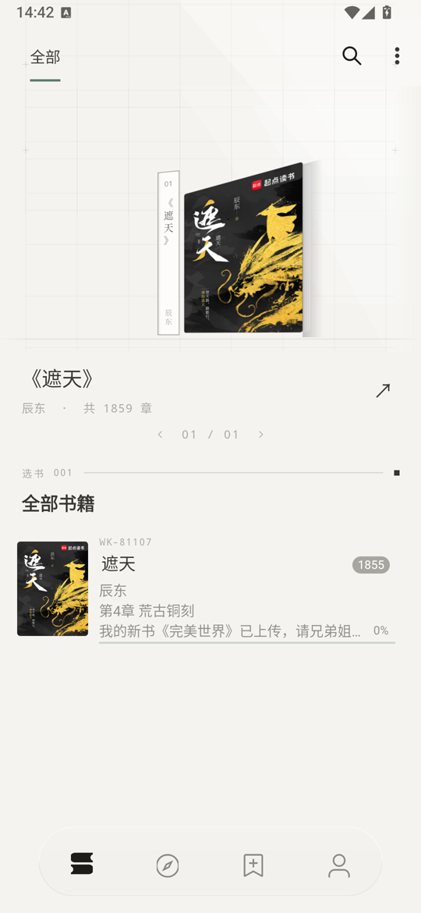

<div align="center">

# 纯净阅读

**一款基于 Legado 深度定制、档案纸风格的 Android 开源阅读器。**
安装即用，内置优质书源，无需四处寻找；轻盈的「流动」翻页、3D 立体书架与悬浮毛玻璃导航，还原轻小说阅读器的精致手感。

[](https://www.gnu.org/licenses/gpl-3.0)
[](#下载安装)
[](#本地构建)

[📥 下载安装包](#下载安装) · [✨ 功能亮点](#功能亮点) · [📸 界面预览](#界面预览) · [🛠 本地构建](#本地构建)

</div>

---

## 📸 界面预览

| 3D 书架 · 首页 | 图书详情 · 档案风 | 阅读页 · 档案纸排版 |
| :---: | :---: | :---: |
|  |  |  |
| 书脊透视排列，封面绕书脊旋出 | 简介 / 目录分区，克制排版 | 墨灰正文、顶格段落、页眉页码 |

---

## 简介

「纯净阅读」源自开源阅读器 [Legado](https://github.com/gedoor/legado)，在保留其强大书源生态与自定义能力的同时，围绕**阅读体验**做了一系列深度定制：从视觉风格、翻页动效到内置书源，目标是**装上就能舒服地看书**。

本项目沿用上游的 **GPL-3.0** 开源协议。

---

## ✨ 功能亮点

### 📚 3D 立体书架
首页书脊按透视角度排列，越靠近两侧倾角越大；选中书籍的封面绕书脊铰链旋出、带书页厚度与投影，滑动时封面随距离平滑收合。

### 🌊 「流动」翻页
参考轻小说的段落级翻页：整页按段落切成条带，各条横向错峰平移（620ms / 起跑错峰 18% / easeInOutSine），像文字在指尖流动。已设为默认翻页方式，旧版本收藏的单本设置也会自动迁移过来。

### 📄 档案纸排版
专门调校的「档案纸」阅读样式——墨灰绿正文（`#30352F`）、22sp 字号、顶格段落、15px 行距、页眉显示章节名与页码，字里行间更接近纸质读物的呼吸感。

### 🧊 悬浮胶囊毛玻璃导航
底部四项导航（书架 / 发现 / 订阅 / 我的）收进居中悬浮胶囊，毛玻璃实时透出列表内容，选中项以实心深色图标区分，克制而轻盈。

### 📦 内置优质书源，安装即可看书
精选 6 个内容健康、规则完整、实测可搜索的山石书源随包内置，**首次启动自动导入**，不联网找源也能直接搜书阅读：

> 笔趣阁⛅ · 精华书阁手机版V2 · 笔趣阁(byqg.cc) · 📚书海阁 · 爱丽丝书屋 · 思兔小说

导入仅在书源库为空时进行，**绝不覆盖**你已有的书源。

### 🎨 定制视觉与细节
- 全新应用名「纯净阅读」与青绿渐变图标
- 首页横向切页缓动，滑动更跟手
- 浅色主题下状态栏图标自动切换深色，清晰可读
- 阅读页返回书架等场景的稳定性修复

---

## 下载安装

- **GitHub Release（推荐）**：[打开 Releases 页面](https://github.com/pure-reader/chunjinyuedu/releases) 下载 `default.apk`
- **源码仓库根目录**：`纯净阅读.apk`

要求 Android 8.0（API 26）及以上。安装后首次进入需同意隐私协议，即可看到内置书源，点击右上角搜索开始阅读。

> 💡 **覆盖安装不会丢失书架数据**：只要包名与签名不变，覆盖安装会保留你的书架、书源和阅读进度。只有「清除数据」或「卸载」才会清空。

---

## 🛠 本地构建

环境：JDK 17 + Android SDK，工程根目录执行：

```bash
# Linux / macOS
./build.sh -Pksp.incremental=false assembleDebug

# Windows
build.cmd -Pksp.incremental=false assembleDebug
```

产物位于 `app/build/outputs/apk/app/debug/app-app-debug.apk`。

> ⚠️ 若 Gradle 缓存与工程位于不同盘符，KSP 增量编译会报 `different roots` 错误，务必带上 `-Pksp.incremental=false` 参数。

---

## 致谢

本项目基于 [Legado](https://github.com/gedoor/legado) 定制，感谢上游团队与所有开源依赖（jsoup、JsoupXpath、OkHttp、Glide、Rhino 等）的贡献。

## 开源协议

```
GNU GENERAL PUBLIC LICENSE Version 3, 29 June 2007
```

详见 [LICENSE](LICENSE)。
